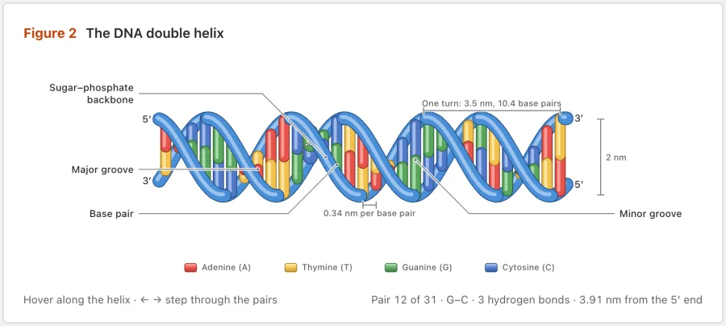
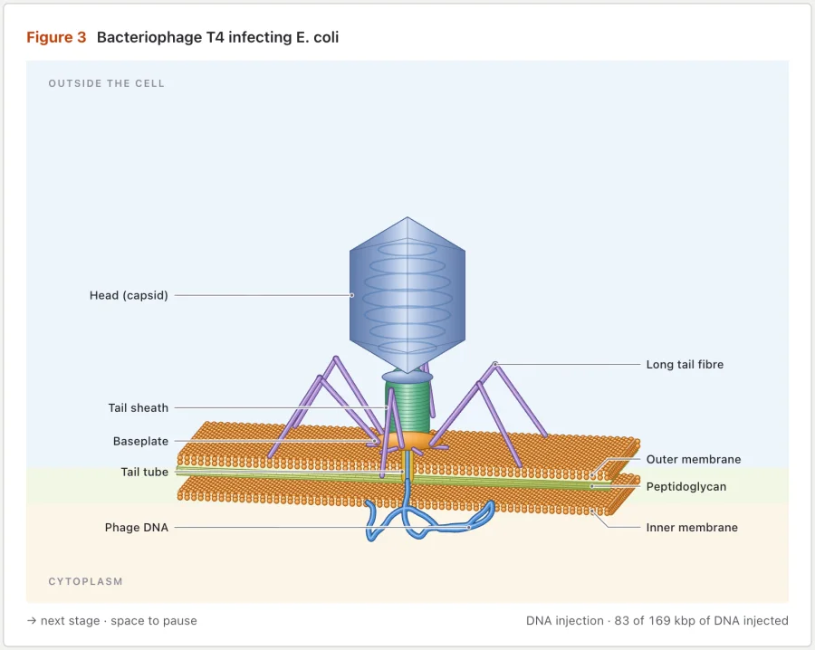
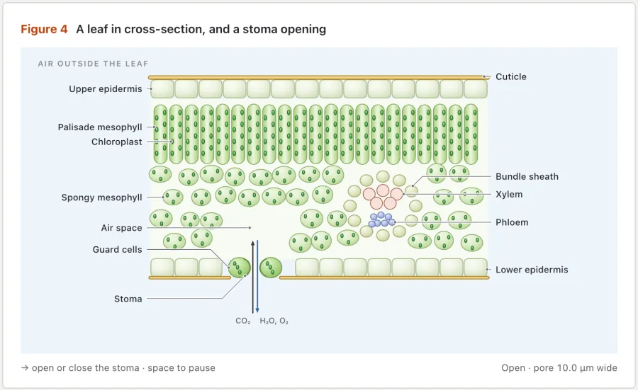
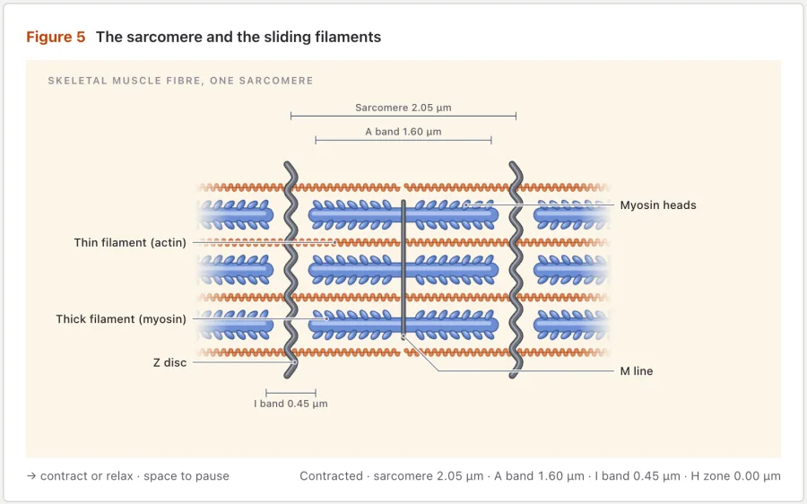

<h1 align="center">Microscope</h1>

<p align="center"><b>A Claude skill for textbook-quality biology figures that move.</b><br>Molecular biology, microbiology, cell biology, botany and zoology.<br>The real structure, colour-coded, labelled and alive, in SVG, with WebGL and 3D when needed.<br>Also runs in Antigravity, OpenCode and Codex.</p>

<p align="center">
  <a href="https://code.claude.com/docs/en/skills"></a>
  <a href="https://agentskills.io"></a>
  <a href="LICENSE"></a>
  <a href="#requirements"></a>
  <a href="#requirements"></a>
  <a href="https://github.com/starhopp3r/microscope/actions/workflows/ci.yml"></a>
</p>

<p align="center">
  <a href="https://github.com/starhopp3r/microscope/archive/refs/heads/main.zip"></a>
  &nbsp;
  <a href="#install"></a>
</p>

<p align="center">
  <a href="#quick-start">Quick start</a> ·
  <a href="#gallery">Gallery</a> ·
  <a href="#what-it-makes">What it makes</a> ·
  <a href="#install">Install</a> ·
  <a href="#usage">Usage</a> ·
  <a href="#examples">Examples</a> ·
  <a href="#how-it-works">How it works</a> ·
  <a href="#limits">Limits</a>
</p>

<p align="center">
  
</p>

<p align="center"><sub><code>examples/atp-synthase</code> (cell biology), light theme. Protons flow down through the stator, turn the eight-subunit c-ring, and one ATP leaves the head every 120°.</sub></p>

---

Ask Claude for a figure of a biological structure or process, and Microscope draws it the way a good textbook would (Campbell Biology, Alberts, OpenStax), then makes it move:
- **The real structure.** Its subunits, layers and counts are true, drawn as soft, colour-coded, shaded shapes.
- **Membranes as phospholipid bilayers,** and compartments as tints.
- **Labels with leader lines** name every part, and arrows show what flows and what turns.

Behind the picture is a small model. The ATP synthase's ring of eight c subunits steps 45° for every proton that crosses the membrane, and the readout counts the protons, the degrees and the ATP made, at the real rate slowed down so you can follow it. Claude checks the biology (counts, handedness, polarity, compartments, scale, sources) and the textbook look before it calls a figure done, and the caption cites its sources.

It never looks like an engineering drawing: no base plates, rulers, screws or monochrome machine parts.

> [!NOTE]
> Microscope is a fork of [Anatomy](https://github.com/wheresryan22/anatomy) by [@wheresryan22](https://x.com/wheresryan22), rebuilt for biology. The camera and the browser checks come from Anatomy. The biology drawing kit (`kit/bio.mjs`), the label check, the textbook style and every example are Microscope's own.

## Quick start

```sh
npx skills add starhopp3r/microscope -g -a claude-code
```

Then, in Claude Code:

```text
/microscope show how ATP synthase makes ATP in mitochondria, interactive
```

For OpenCode or Codex, swap the agent: `-a opencode` or `-a codex`. OpenCode takes the same `/microscope` command; in Codex, type `$microscope`.

That's it. No API keys and nothing to `npm install`: the kit uses only Node's built-in modules.

## Gallery

<table>
  <tr>
    <td width="50%"></td>
    <td width="50%"></td>
  </tr>
  <tr>
    <td><sub><b>dna-double-helix</b> (molecular biology): hover along the helix to read each base pair and its two or three hydrogen bonds.</sub></td>
    <td><sub><b>t4-phage</b> (microbiology): the phage lands on its tail fibres, contracts its sheath, drives its tube through the envelope and injects its 169 kbp genome.</sub></td>
  </tr>
  <tr>
    <td></td>
    <td></td>
  </tr>
  <tr>
    <td><sub><b>leaf-stoma</b> (botany): the guard cells take up water and swell, and the stoma opens and closes.</sub></td>
    <td><sub><b>sarcomere</b> (zoology): the filaments slide; the sarcomere, I band and H zone shorten while the A band keeps its length.</sub></td>
  </tr>
</table>

Every screenshot is the light theme of a page in [`examples/`](examples), captured with the skill's own [`scripts/capture.mjs`](scripts/capture.mjs) and [`scripts/drive.mjs`](scripts/drive.mjs). The built pages are committed: open any `.html` in `examples/` to try it.

## What it makes

Figures of living things, at whatever level the idea lives:

| Field | For example |
|---|---|
| **Molecular biology** | DNA and its replication fork, transcription, a ribosome translating mRNA, Cas9 cutting at a PAM, an enzyme's active site |
| **Cell biology** | ATP synthase in the inner mitochondrial membrane, kinesin walking a microtubule, the sarcomere, an action potential along a myelinated axon, a synapse, the mitotic spindle, the nuclear pore |
| **Microbiology** | The flagellar motor and run-and-tumble, Gram-positive and Gram-negative envelopes, a T4 phage injecting its genome, a virion fusing with a membrane, budding yeast |
| **Botany** | A leaf section with opening stomata, a chloroplast's grana, xylem and transpiration, a root tip, a flower cut lengthwise with a pollen tube growing |
| **Zoology** | A fish gill's countercurrent exchange, a four-chambered heart through its cycle, an insect thorax driving its wings, an arthropod leg's segments and joints |
| **Lab methods** | A compound microscope, a PCR thermocycler, a gel electrophoresis tank, a centrifuge rotor |

Every figure is textbook-style SVG built with `kit/bio.mjs`: soft gradient bodies, bilayers, DNA helices, ropes for strands and stalks, process arrows and labels, in the figure's own 3D camera, redrawn every frame as the model moves. It ships as a standalone HTML page, a lone `.svg` file, or React/Next.js components. When SVG isn't enough, the inherited kit adds a WebGL layer (fluorescence, light in a leaf, water) or true 3D turning (beta), drawn in the same palette.

Each figure is light or dark. Light is the theme the skill designs for first, shaders included.

## Install

Microscope is a standard [Agent Skill](https://agentskills.io): a folder with a `SKILL.md` at its root. This repository is that folder. Pick one way in:

| | Command | Installs to |
|---|---|---|
| **skills CLI**, for you (Claude Code) | `npx skills add starhopp3r/microscope -g -a claude-code` | `~/.claude/skills/microscope` |
| **skills CLI**, for you (Antigravity) | `npx skills add starhopp3r/microscope -g -a antigravity` | `~/.gemini/antigravity/skills/microscope` |
| **skills CLI**, for you (OpenCode) | `npx skills add starhopp3r/microscope -g -a opencode` | `~/.config/opencode/skills/microscope` |
| **skills CLI**, for you (Codex) | `npx skills add starhopp3r/microscope -g -a codex` | `~/.agents/skills/microscope` |
| **skills CLI**, for one project | `npx skills add starhopp3r/microscope` | `.claude/skills/microscope` for Claude Code, `.agents/skills/microscope` for Antigravity, OpenCode and Codex |
| **git**, for you (Claude Code) | `git clone https://github.com/starhopp3r/microscope.git ~/.claude/skills/microscope` | `~/.claude/skills/microscope` |
| **git**, for you (Antigravity) | `git clone https://github.com/starhopp3r/microscope.git ~/.gemini/antigravity/skills/microscope` | `~/.gemini/antigravity/skills/microscope` |
| **git**, for you (OpenCode) | `git clone https://github.com/starhopp3r/microscope.git ~/.config/opencode/skills/microscope` | `~/.config/opencode/skills/microscope` |
| **git**, for you (Codex) | `git clone https://github.com/starhopp3r/microscope.git ~/.agents/skills/microscope` | `~/.agents/skills/microscope` |
| **git**, for one project | `git clone https://github.com/starhopp3r/microscope.git .claude/skills/microscope` | `.claude/skills/microscope` (Claude Code and OpenCode) or `.agents/skills/microscope` (Antigravity, OpenCode and Codex) |
| **Download**, no git | see below | any of the folders above |

<details>
<summary><b>With the skills CLI</b></summary>

<br>

The [`skills`](https://github.com/vercel-labs/skills) CLI finds the `SKILL.md` at the root of this repository and installs it as `microscope`. By default it installs into the current project and asks which agents to set up. `-g` installs it for your user, and `-a claude-code` sets up Claude Code only. Use `-a antigravity`, `-a opencode` or `-a codex` for Antigravity, OpenCode or Codex only.

The CLI copies the whole repository, examples included (about 10 MB). It needs a recent Node.js: version 1.7.1 of the CLI asks for 22.20 or later.

</details>

<details>
<summary><b>With git</b></summary>

<br>

Clone the repository into one of the skill folders, so that `SKILL.md` ends up at `<skills folder>/microscope/SKILL.md`. For Claude Code use `~/.claude/skills/microscope` or `.claude/skills/microscope`. For Antigravity use `~/.gemini/antigravity/skills/microscope` or `.agents/skills/microscope`. For OpenCode use `~/.config/opencode/skills/microscope` or `.opencode/skills/microscope`; OpenCode also reads the Claude Code and `.agents` folders. For Codex use `~/.agents/skills/microscope` or `.agents/skills/microscope`. For a project install, commit the folder so your team gets it too. To update later, `git pull` inside that folder.

</details>

<details>
<summary><b>Download, without git</b></summary>

<br>

[Download the ZIP](https://github.com/starhopp3r/microscope/archive/refs/heads/main.zip), unpack it, rename the folder from `microscope-main` to `microscope`, and move it into `~/.claude/skills/` (Claude Code), `~/.gemini/antigravity/skills/` (Antigravity), `~/.config/opencode/skills/` (OpenCode) or `~/.agents/skills/` (Codex).

Or in one line on macOS or Linux:

```sh
mkdir -p ~/.claude/skills/microscope && curl -L https://github.com/starhopp3r/microscope/archive/refs/heads/main.tar.gz | tar -xz --strip-components=1 -C ~/.claude/skills/microscope
```

For Antigravity, OpenCode or Codex, put the same files in `~/.gemini/antigravity/skills/microscope`, `~/.config/opencode/skills/microscope` or `~/.agents/skills/microscope`:

```sh
mkdir -p ~/.gemini/antigravity/skills/microscope && curl -L https://github.com/starhopp3r/microscope/archive/refs/heads/main.tar.gz | tar -xz --strip-components=1 -C ~/.gemini/antigravity/skills/microscope
```

```sh
mkdir -p ~/.config/opencode/skills/microscope && curl -L https://github.com/starhopp3r/microscope/archive/refs/heads/main.tar.gz | tar -xz --strip-components=1 -C ~/.config/opencode/skills/microscope
```

</details>

Claude Code picks up new skills in a running session. If the `skills` folder itself did not exist when the session started, run `/reload-skills`. Antigravity and OpenCode list it as `/microscope` in their chat; restart if it does not show. Codex lists it under `/skills` and runs it with `$microscope`; restart Codex if it does not show.

<details>
<summary><b>Codex: if the browser checks are blocked</b></summary>

<br>

The skill checks its own figures by starting headless Chrome, which writes a temporary profile and talks to it over a local port. Codex runs commands in a sandbox, and that sandbox may stop Chrome. The figure is still built; only its checks fail. In order of preference:

1. When Codex asks to run a check outside the sandbox, approve it for that command. This needs the default `approval_policy = "on-request"`.
2. Or allow it once in `~/.codex/config.toml`:

   ```toml
   approval_policy = "on-request"
   sandbox_mode = "workspace-write"

   [sandbox_workspace_write]
   network_access = true
   writable_roots = ["/tmp"]
   ```

   Newer Codex releases may name these settings differently; check the config reference for your version.
3. Or run the check yourself in a normal terminal, for example `node scripts/capture.mjs page.html --out shots/page.png`.

Starting Codex with `--sandbox danger-full-access` also works, but it lifts every limit for that session, so keep it for projects you trust.

</details>

## Usage

Type `/microscope` (in Codex, `$microscope`) and say what the figure should show:

```text
/microscope show how ATP synthase makes ATP in mitochondria, interactive
```

You don't have to name the skill. Claude also loads it when you ask for a biology, microbiology, molecular biology, cell biology, botany or zoology illustration, a figure for a lecture, course, paper, poster or blog post, or an interactive explainer of a biological structure or process. Antigravity, OpenCode and Codex do the same.

<details>
<summary><b>More prompts</b>, from the skill's <a href="evals/evals.json">evals</a></summary>

<br>

```text
/microscope E. coli's flagellar motor in its cell envelope, and how switching rotation direction makes it run or tumble. A React component for our Next.js site plus a static HTML preview, dark theme.
```

```text
/microscope a leaf cross-section showing how stomata open and close, for a botany lecture slide. Light theme, just the SVG file and a PNG preview.
```

```text
/microscope a bacterial ribosome translating an mRNA: tRNAs moving through the A, P and E sites and the chain growing. One HTML file, dark theme.
```

```text
/microscope a bony fish gill arch showing countercurrent exchange, water one way over the lamellae and blood the other. Standalone HTML, light theme.
```

```text
/microscope an agarose gel electrophoresis tank with a DNA ladder and three samples running; show the bands separating by size when the power is on. One HTML file, light theme.
```

</details>

Four habits get the best figures:

1. **Name the process and the organism.** Say what it should show and in which organism (bovine mitochondria, E. coli, a eudicot leaf, a honeybee), and give any numbers you care about (stoichiometry, rates, sizes, counts). Microscope picks the level of scale, the view and the layout of labels and arrows.
2. **Or name the structure and the view.** If you already know what you want (a sarcomere, a T4 phage, a lily flower cut lengthwise, a leaf cross-section), say so, and say what should move.
3. **Say who it is for.** A first-year lecture, a methods tutorial or a review figure changes how much is shown and how many parts are labelled.
4. **Say where it will live.** A standalone HTML page, a lone SVG file, or a React/Next.js component; light or dark. The build differs for each.

A figure arrives as source you own: a Node build script and the page it writes, or, for React, geometry modules, a server component for the static art and one client component for the motion. The kit comes with it.

## Examples

Five complete figures, one per field. Each has a Node build script that writes standalone pages next to itself; add `--light` for the light theme. Every one passes `scripts/labels.mjs` with 0 problems at rest and in motion, in both themes.

| Example | Field | What it shows | Build |
|---|---|---|---|
| [`atp-synthase`](examples/atp-synthase) | Cell biology | Mitochondrial ATP synthase in a phospholipid bilayer: colour-coded rotor, stator, central stalk and α₃β₃ head, an H⁺ gradient, flow and rotation arrows. Protons step the eight-subunit ring 45° at a time, and one ATP leaves the head every 120°. The reference for the style. | `node examples/atp-synthase/build.mjs` |
| [`dna-double-helix`](examples/dna-double-helix) | Molecular biology | Right-handed B-DNA with coloured base pairs, 5′ and 3′ ends, major and minor grooves, measurement brackets and a key. Hover a base pair to see its hydrogen bonds. | `node examples/dna-double-helix/build.mjs` |
| [`t4-phage`](examples/t4-phage) | Microbiology | Bacteriophage T4 infecting E. coli through the Gram-negative envelope: attachment, tail contraction and DNA injection, with labels that follow their parts. | `node examples/t4-phage/build.mjs` |
| [`leaf-stoma`](examples/leaf-stoma) | Botany | A broad bean leaf in cross-section, from cuticle to lower epidermis, with a vein, and guard cells that swell to open the stoma while CO₂ enters and H₂O and O₂ leave. | `node examples/leaf-stoma/build.mjs` |
| [`sarcomere`](examples/sarcomere) | Zoology | One sarcomere of skeletal muscle: Z discs, actin, myosin and the M line, with band brackets that update as the filaments slide. | `node examples/sarcomere/build.mjs` |

## How it works

- **[`SKILL.md`](SKILL.md)** is what Claude reads. It sets the textbook style and the workflow: collect the true numbers for the organism, choose the textbook view, list the parts, labels and arrows, draw with `kit/bio.mjs`, paint back to front, frame it as a textbook figure, make it live, then review the biology and the look.
- **[`references/biology.md`](references/biology.md)** is the domain guide: the textbook style, colour conventions, views and levels of scale, concepts and how textbooks draw them, true numbers, recipes for every biological form, counts, handedness, polarity and compartments, labels and arrows, biological time, and the review.
- **[`kit/bio.mjs`](kit/bio.mjs)** is the biology drawing kit: the palette, gradient bodies (`sphere`, `ellipsoid`, `capsule`), `rope`, `bilayer`, `membraneLoop`, `doubleHelix`, `arrow`, `label` and `region`. It uses the camera in `kit/iso-kit.mjs`. The rest of [`kit/`](kit) is Anatomy's engineering kit, kept for its geometry, WebGL layer and 3D mode.
- **Verification.** In headless Chrome, [`scripts/labels.mjs`](scripts/labels.mjs) checks every label and arrow at rest and across frames of motion: leaders horizontal or a single 45° elbow ending in a dot on the part, nothing crossing, no overlapping text, no moving part passing over a label. [`scripts/capture.mjs`](scripts/capture.mjs) and [`scripts/drive.mjs`](scripts/drive.mjs) take screenshots, close-ups and slowed-down contact sheets in both themes, and the skill tells Claude to read every PNG it makes against the biology and textbook review.

<details>
<summary><b>Repository layout</b></summary>

<br>

```text
microscope/
├── SKILL.md                  the skill: textbook style, workflow, biology rules
├── kit/                      the drawing library
│   ├── bio.mjs               the biology kit: palette, soft bodies, bilayer, DNA, arrows, labels
│   ├── iso-kit.ts            the camera, plus Anatomy's solids, parts, card and page
│   ├── iso-kit.mjs           the same core as plain ESM, for Node build scripts
│   ├── iso.css               the kit's CSS, both themes
│   ├── react/                draw.tsx (server-safe components), live.tsx (client hooks)
│   ├── lathe.mjs             round parts on any axis
│   ├── tube.mjs              pipes, tubes and cables
│   ├── audit.mjs             the geometry audit
│   ├── gl.mjs                the WebGL layer for shaders inside the drawing
│   ├── turn.mjs              the 3D runtime (beta)
│   ├── turn-build.mjs        the 3D builder
│   ├── turn-audit.mjs        the 3D orbit audit
│   └── turn-fixed.mjs, canvas-painter.mjs, gl-shared.mjs
│                             experimental variants, not yet documented
├── references/               long-form guides Claude reads as needed
│   ├── biology.md  motion.md  react.md  verify.md  publish.md
│   └── kit.md  craft.md  webgl.md  3d.md   (inherited from Anatomy)
├── scripts/                  headless Chrome checks and build helpers
│   ├── capture.mjs           screenshots and close-ups
│   ├── drive.mjs             scripted sessions and contact sheets
│   ├── labels.mjs            the label and arrow check for biology figures
│   ├── lines.mjs             the line-end check (with line-ends.mjs)
│   ├── inline-kit.mjs        the kit as source, to inline into a standalone page
│   ├── turn-check.mjs        3D checks in the browser (with turn-fidelity.mjs)
│   └── turn-bench.mjs        3D timing in Node
├── examples/                 five biology figures, built pages committed
├── evals/evals.json          test prompts and what a good answer contains
└── .github/                  issue forms, PR template, CI, README images
```

</details>

## Requirements

| | Needed for | Notes |
|---|---|---|
| **[Claude Code](https://code.claude.com/docs/en/overview)**, or [Antigravity](https://antigravity.google), [OpenCode](https://opencode.ai/docs/skills/) or [Codex](https://developers.openai.com/codex/skills) | everything | The skill is written for Claude Code and follows the open Agent Skills format, so Antigravity, OpenCode and Codex load it too. In Codex, the browser checks start Chrome; if its sandbox blocks that, allow it for those commands. |
| **Node.js 20.10+** | builds, kit, checks | Built-in modules only: nothing to `npm install`. The examples were rebuilt byte for byte on Node 20.19 and 22.11. On Node 20 the browser scripts restart themselves with `--experimental-websocket`. |
| **Chrome or Chromium** | the checks | `capture.mjs`, `drive.mjs`, `labels.mjs`, `lines.mjs` and `turn-check.mjs` look in the usual places on macOS, Linux and Windows and in Playwright's cache. Set `CHROME_PATH` for any other binary. They run it headless with WebGL on. |
| **React 18+** | React output only | `kit/react/`. |

## Limits

- **It is not a chart library.** There are no axes, series or data plots: no volcano plots, phylogenetic trees or growth curves. Numbers appear as a live readout driven by a model, and as the true sizes and counts of the parts.
- **It draws biology the way textbooks do.** Molecules, cells, tissues, organs, plants and animals, and the techniques that study them, as clear simplified illustrations. It does not draw whole people, faces or exact maps, and it is not a molecular viewer: it draws a textbook-style model from a structure's facts rather than rendering atomic coordinates. An idea with no structure to draw, such as a whole metabolic network, comes out weaker; pick the enzyme or compartment that carries one step.
- **It is only as true as its sources.** The skill collects real numbers and checks counts, handedness, polarity and compartments, but have an expert review a figure before it goes into teaching material or a paper.
- **It takes care.** A figure takes a session: the facts and sources, the layout of labels and arrows, the drawing, and close-ups in both themes.
- **Shaders need WebGL.** Without it the SVG still reads, and under reduced motion every figure goes still.

> [!NOTE]
> **The 3D mode is beta.** It is proved on its example and one test figure, not yet on a production figure. A small 3D figure runs at 60 fps; the 380-part stress hand measured about 20 fps at 1440 px wide and 13 to 15 fps on a throttled phone profile, on a heavily loaded machine.

## Share a figure

Made something good? Ask your agent to *"publish this figure to the Microscope community gallery"*. It asks for a title and your GitHub name, shows what it will send, and after your yes opens a pull request on [microscope-community](https://github.com/starhopp3r/microscope-community) for you: no git, no forking by hand. Or run `scripts/publish.mjs --submit` yourself. Without a terminal, use the gallery's **Submit a figure** form with a GitHub Gist.

## Contributing

Issues and pull requests are welcome. Read [CONTRIBUTING.md](CONTRIBUTING.md) first: it covers building the examples, the checks, and the house rules a change has to keep (among them, no comments in code, and kit changes that leave every existing example byte-identical). Please follow the [Code of Conduct](CODE_OF_CONDUCT.md), and report security problems as described in [SECURITY.md](SECURITY.md).

- [Report a bug](https://github.com/starhopp3r/microscope/issues/new?template=bug_report.yml)
- [Request a figure](https://github.com/starhopp3r/microscope/issues/new?template=figure_request.yml)
- [Changelog](CHANGELOG.md)

## License

[MIT](LICENSE) © 2026 Ryan · [@wheresryan22](https://x.com/wheresryan22). Microscope is a fork of [Anatomy](https://github.com/wheresryan22/anatomy), tuned for biology.

<p align="center"><sub>If Microscope drew something useful for you, a ⭐ helps other people find it.</sub></p>
